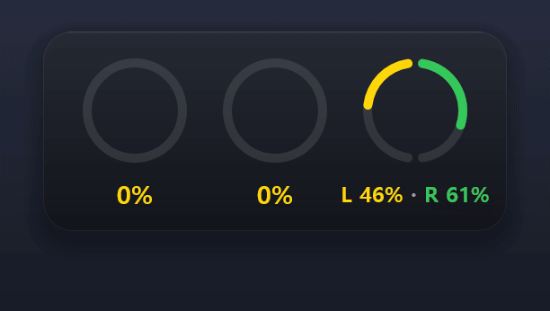
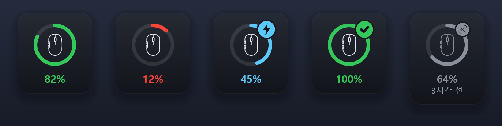
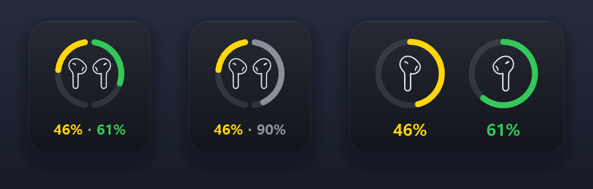
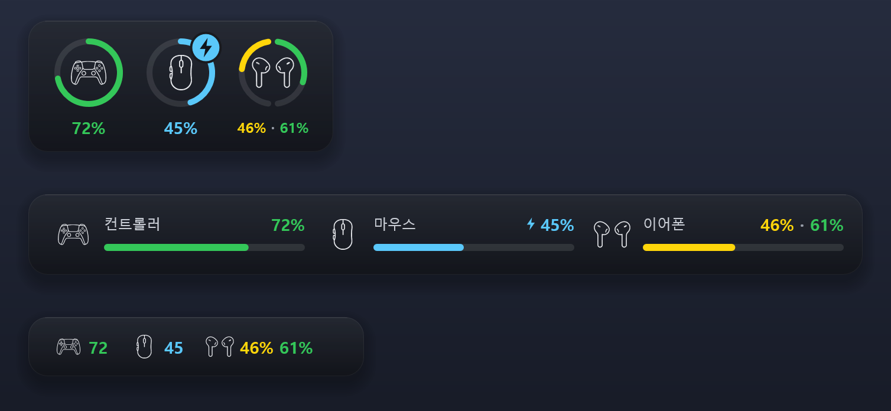
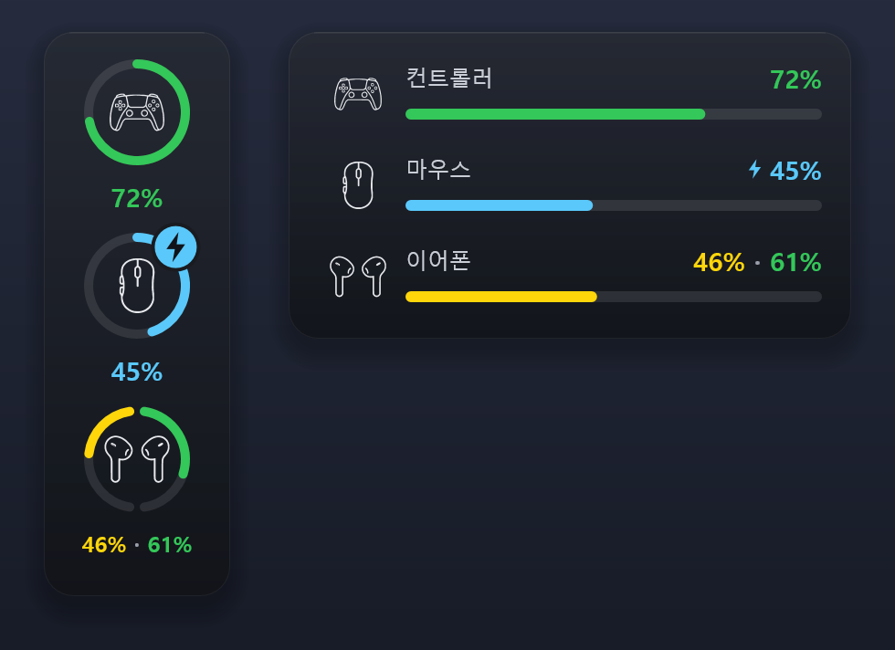
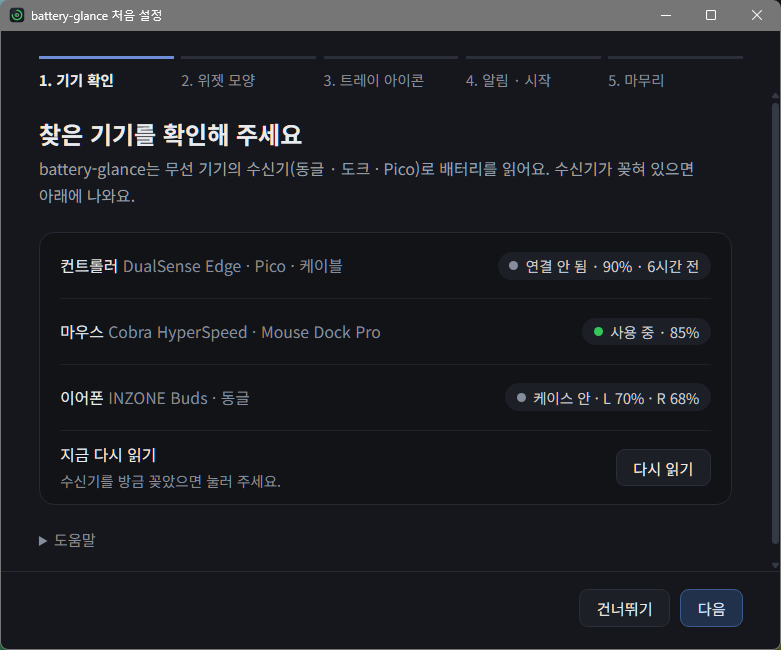
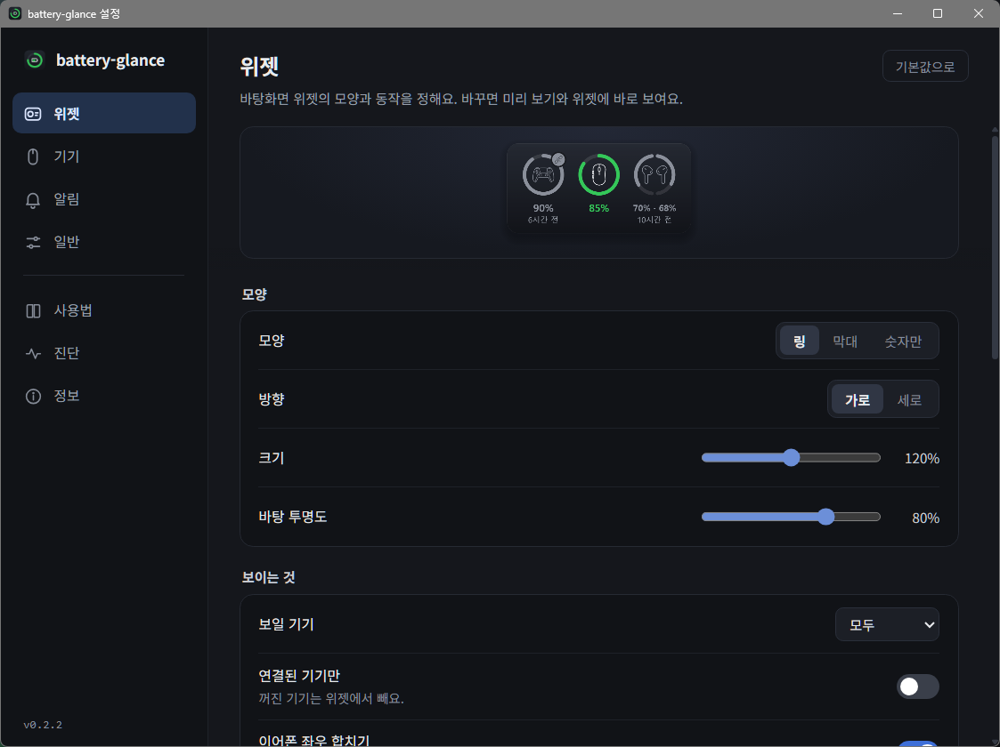
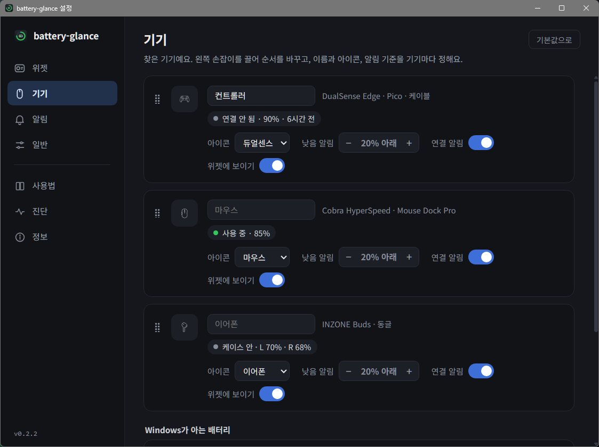
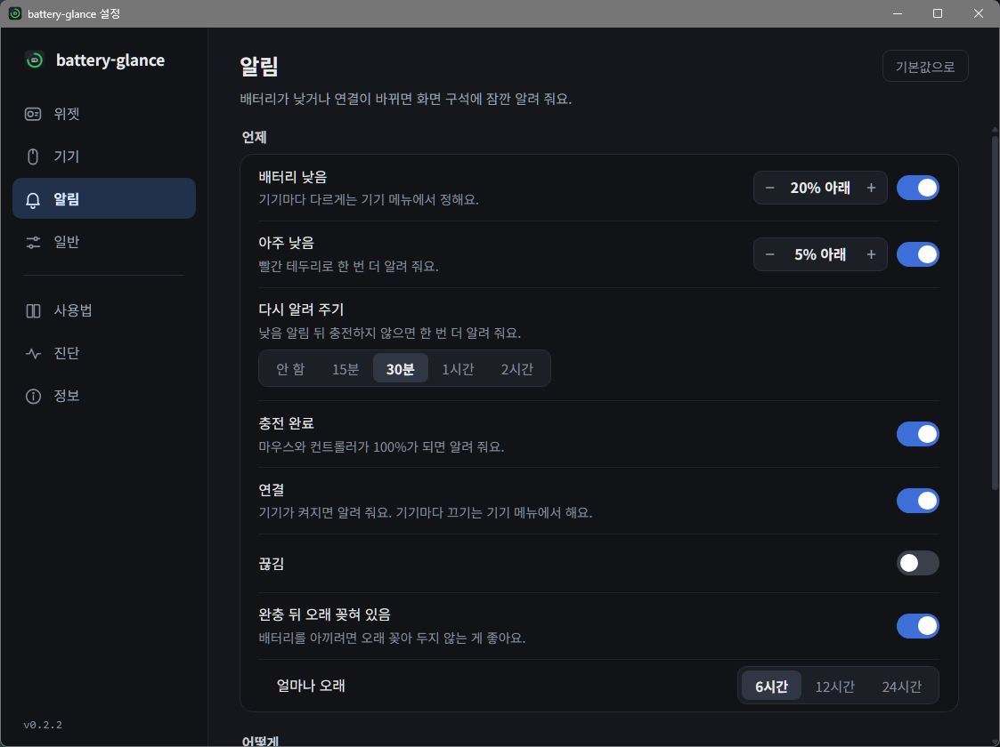
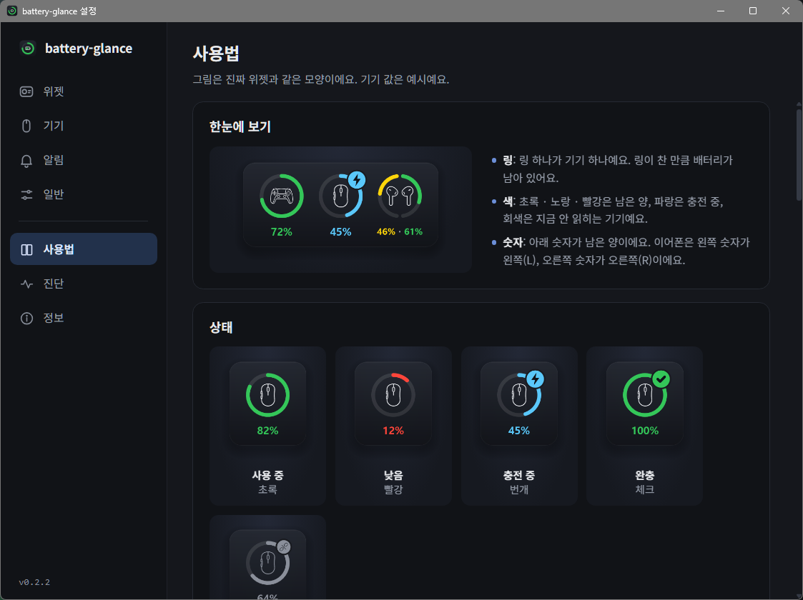

# 🔋 battery-glance

**무선 기기 배터리를 흘깃 보고 아는 Windows 위젯**

서브모니터 구석에 띄워 두면 **컨트롤러 · 마우스 · 이어폰이 얼마나 남았는지** 한눈에 보여요.
충전을 시작하면 파랗게, 낮아지면 빨갛게 바뀌고, 필요할 때만 화면 구석에 잠깐 알려 줘요.

  

## 🎮 지원 기기

| 기기 | 연결 |
|---|---|
| Sony **INZONE Buds** | USB 동글 (좌우 따로 · 케이스 안 · 착용까지) |
| Razer **Cobra HyperSpeed** | Mouse Dock Pro · USB 케이블 |
| Sony **DualSense Edge** | DS5 Bridge 수신기(Pico) · USB 케이블 |
| 블루투스 기기 · 노트북 | Windows 설정에 배터리가 나오는 기기 (블루투스는 시험 중) |

기기 제조사 앱(INZONE Hub · Razer Synapse)이 없어도 돼요. 수신기가 보내는 배터리 신호를 직접 읽어요.

## 📸 둘러보기

### 링 하나가 기기 하나
링이 찬 만큼 남아 있어요. **초록 · 노랑 · 빨강**은 남은 양, **파랑**은 충전 중, **회색**은 지금 안 읽히는 기기예요.
연결이 끊긴 기기는 마지막으로 읽은 값과 시각("3시간 전")을 남겨 둬요.

  

### 이어폰은 왼쪽 · 오른쪽 따로
반반 링 하나로 보여 줘요. **왼쪽 반이 L, 오른쪽 반이 R**이에요. 아래 숫자도 왼쪽이 L, 오른쪽이 R이고 쪽마다 제 색을 따라가요. 케이스에 넣은 쪽은 회색이 돼요.
좌우 합치기를 끄면 두 개로 나눠 보여요.

  

### 모양 · 방향 · 크기
**링 · 막대 · 숫자만** 중에서 고르고, 가로나 세로로 놓아요. 크기와 바탕 투명도, 잔량 색도 바꿀 수 있어요.

  

  

### 알림 · 트레이
- 배터리가 **낮아지면**(기본 20% · 아주 낮으면 5%) 화면 구석에 잠깐 알려 줘요. 충전하지 않으면 30분 뒤 한 번 더 알려요.
- **충전 완료 · 연결**도 알려 줘요. 윗줄은 무슨 일, 아랫줄은 어느 기기, 숫자는 오른쪽에 크게 보여요.
- 알림의 **크기 · 모니터 · 자리(9곳)** 를 고를 수 있어요.
- 작업 표시줄 트레이 아이콘은 **프로그램 아이콘 · 작은 배터리(가장 낮은 기기) · 기기마다 따로** 중에서 골라요.
- **단축키**를 정해 두면 게임 위에 위젯을 잠깐 띄울 수 있어요 (창 모드 전체화면에서).

### 설정 · 처음 설정 · 사용법

<table>
  <tr>
    <td align="center" width="50%"></td>
    <td align="center" width="50%"></td>
  </tr>
  <tr>
    <td align="center"><b>처음 켜면</b> 기기 확인 → 위젯 모양 → 트레이 아이콘 → 알림 · 시작</td>
    <td align="center"><b>위젯</b> 바꾸면 미리 보기와 위젯에 바로 보여요</td>
  </tr>
  <tr>
    <td align="center"></td>
    <td align="center"></td>
  </tr>
  <tr>
    <td align="center"><b>기기</b> 끌어서 순서 · 이름 · 아이콘 · 기기마다 알림 기준</td>
    <td align="center"><b>알림</b> 언제 · 어떻게 · 미리 띄워 보기</td>
  </tr>
  <tr>
    <td align="center"></td>
    <td align="center"></td>
  </tr>
  <tr>
    <td align="center"><b>사용법</b> 진짜 위젯 그림으로 하나씩</td>
    <td align="center"></td>
  </tr>
</table>

사진 속 기기 값은 예시예요.

---

## ⬇️ 설치하기

1. 오른쪽 **Releases** 에서 가장 위(Latest) 버전을 열어요.
2. **`BatteryGlance_버전_x64-setup.exe`** 하나만 받아서 실행해요.
   (다른 파일 `latest.json`, `.sig` 는 자동 업데이트용이라 받지 않아도 돼요.)
3. 설치가 끝나면 위젯이 뜨고, 처음엔 **처음 설정** 창이 열려요.

> **"Windows의 PC 보호" 파란 창이 뜨면?**
> 아직 널리 알려지지 않은 개인 프로그램이라 Windows가 한 번 확인하는 창이에요.
> **추가 정보 → 실행** 을 누르면 설치돼요.

- 관리자 권한 없이 **내 계정에만** 설치돼요.
- 필요한 것: Windows 10 / 11 (64비트)
- 처음 설치하면 **Windows 켤 때 같이 켜져요.** 끄려면 설정 → 일반 → Windows 켤 때 같이 켜기
- 지우려면: Windows **설정 → 앱 → 설치된 앱 → BatteryGlance → 제거**. 자동 실행 등록도 같이 지워져요.
  설정 폴더는 남아 있어서 다시 설치하면 그대로 이어져요 (제거 화면에서 "앱 데이터 삭제"를 고르면 같이 지워요).

## 🔄 자동 업데이트

새 버전이 나오면 알아서 알려 줘요. 켤 때, 그리고 하루 한 번 확인해요.

- 위젯의 **톱니 자리에 초록 점**, 트레이 메뉴에 "**새 버전으로 업데이트**", 설정 → 정보에 업데이트 버튼이 생겨요.
- 누르면 받아서 설치하고 다시 켜져요. **누르기 전에는 아무것도 바뀌지 않아요.**
- 업데이트하면 **바뀐 점** 을 한 번 보여 줘요. 지난 내용은 **설정 → 정보** 에 있어요.
- 모든 업데이트 파일에는 **디지털 서명** 이 붙어 있어요. 서명이 맞는 파일만 설치해요.

---

## 🎛️ 이렇게 써요

| 하고 싶은 것 | 방법 |
|---|---|
| 위젯 옮기기 | 위젯을 끌기 (모니터마다 자리를 기억) · 우클릭 → 위치 고정 |
| 자세히 보기 | 위젯에 마우스 올리기: 기기 이름 · 상태 · 마지막 충전 시각 |
| 설정 열기 | 위젯에 마우스를 올리면 왼쪽 위에 생기는 **톱니** · 트레이 우클릭 → 설정 |
| 위젯 숨기기 / 보이기 | 트레이 아이콘 왼쪽 클릭 |
| 늘 맨 위에 두기 | 위젯 우클릭 → 항상 위 (전체화면 영상 · 게임이 뜨면 알아서 숨어요) |
| 게임 위에 잠깐 보기 | 설정 → 일반 → 단축키 (누르는 동안 · 토글) |
| 기기 이름 · 아이콘 · 순서 | 설정 → 기기 |
| 알림 기준 바꾸기 | 설정 → 알림 (기기마다 다르게는 설정 → 기기) |
| 설정 창 글씨 키우기 | 설정 → 일반 → 글씨 크기 · Ctrl + 휠 |
| 말풍선 · 알림 크기 | 설정 → 위젯 → 말풍선 크기 · 설정 → 알림 → 크기 |

---

## 💾 설정은 어디에?

설정은 **내 컴퓨터에만** 저장돼요.

- 위치: `%USERPROFILE%\.batteryglance\` (예: `C:\Users\내이름\.batteryglance`)
- **설정 → 일반 → 설정 파일 → 내보내기 / 가져오기** 로 파일 하나에 담아 옮길 수 있어요.
- 문제가 생기면 같은 폴더의 `log.txt` (기록 파일)를 보면 원인을 찾기 쉬워요. **설정 → 진단** 에서 바로 열 수 있어요.

## 🔒 개인정보

- 기기에서는 **배터리 · 충전 · 연결 상태만** 읽어요. 기기 설정은 바꾸지 않아요.
- 인터넷은 두 가지에만 써요: **새 버전 확인**(GitHub), 직접 보내는 **문의하기**.
- 설정 · 기록 파일은 내 컴퓨터(`%USERPROFILE%\.batteryglance\`)에만 있어요.

## 💌 문의 · 버그 제보

앱 안 **설정 → 정보 → 문의하기** 에서 만든 사람에게 바로 보낼 수 있어요.

- 보내지는 것: 적은 글, 종류(버그 · 제안 · 기타), 적었다면 연락처, 앱 버전 · 기기 이름과 상태
- 기록 파일(log.txt 끝부분)도 같이 보내요. 기기 이름과 상태가 들어 있어서, 보내기 싫으면 **기록 파일 같이 보내기** 체크를 풀어 주세요.

## ❓ 자주 묻는 질문

**기기가 안 보여요 / "동글 없음"이라고 나와요.**
수신기(동글 · 도크 · Pico)가 꽂혀 있는지 확인하고 **설정 → 기기 → 지금 다시 읽기** 를 눌러 주세요.
INZONE Hub나 Razer Synapse가 켜져 있으면 못 읽을 수 있어요. **설정 → 진단** 에서 기기마다 상태를 볼 수 있어요.

**위젯이 안 보여요.**
작업 표시줄 오른쪽 아래 **트레이 아이콘** 을 왼쪽 클릭하면 보이기 / 숨기기예요.
Windows 11은 새 아이콘을 숨김 영역(^)에 넣어요. ^ 를 누르고 아이콘을 작업 표시줄로 끌어 놓으면 늘 보여요.

**게임 중에 위젯이 안 떠요.**
**독점 전체화면** 게임 위에는 위젯과 알림이 뜰 수 없어요. 게임 설정에서 **창 모드 전체화면(테두리 없음)** 을 골라 주세요.

**위젯을 눌러도 뒤의 창이 눌려요.**
**클릭 통과** 가 켜져 있어요. 트레이 아이콘 우클릭 → 클릭 통과를 꺼 주세요.

## 🍃 가볍게

기기가 스스로 보내는 신호를 기다렸다가 받아요. 계속 묻지 않아요 (컨트롤러는 15초, 케이블로 꽂은 마우스는 30초에 한 번).
위젯과 알림은 웹 화면 없이 직접 그려서, 설정 창을 닫으면 웹 화면이 남지 않아요.

| 상황 | CPU | 메모리 |
|---|---|---|
| 가만히 | 약 0.1% | 약 16MB |

---

Tauri · Rust 로 만들었어요. 이 저장소는 설치 파일과 자동 업데이트 파일을 나눠 주는 곳이에요. 기기 이름은 각 회사의 상표예요.
